# Ouro-2.6B: addition parity and GSM8K pilot

Status: completed as a pilot; findings compare these checkpoints on limited workloads and do not establish a general SOTA or architecture claim.

## Objective

Evaluate ByteDance/Ouro-2.6B as a practical open looped-LM candidate. First repeat the exact seeded addition control from study 04 to preserve a direct comparison, then measure a deterministic GSM8K test subset. Record quality, end-to-end generation latency, output throughput, and peak PyTorch memory on the RTX 3090.

## Candidate selection

Ouro-2.6B is selected as a promising, publicly available looped LM with a first-party model card and published evaluation. This is a practical candidate, not a claim that it is the definitive current SOTA. The paper reports parameter-efficient performance for Ouro-1.4B/2.6B and the release exposes custom Transformers code and recurrent-step controls.

## S1: addition sanity check

The original S1 run evaluated the 20 additions. A follow-up run at depth 32 gave Huginn 19/20 after fixing the scoring regex. Ouro scored 20/20 at depth 4 and 19/20 at depth 8. The prior studies' reported addition numbers were too low before scorer correction; current raw outputs and recalculated totals are included in the study 04 files. The GSM8K tests below use exactly 100 seeded indices from the official test split.

## Architecture: Ouro looped stack vs Qwen3 dense stack

Ouro reuses the same transformer stack multiple times for each token. At the tested depth of 4, the hidden representation passes through the shared 48-layer stack four times; the weights are shared across passes, not copied into four independent stacks. The recurrent loop adds computation without increasing the number of distinct layer weights. Qwen3-8B instead applies its decoder layers once in sequence; its layers have distinct weights, with no Ouro-style recurrence. Both models autoregressively emit tokens, feeding generated tokens back as input until the answer or token limit. See the [Ouro project page](https://ouro-llm.github.io/) and [Qwen3-8B model page](https://huggingface.co/Qwen/Qwen3-8B).

```mermaid
flowchart TB
  subgraph Ouro["Ouro-2.6B · shared recurrent stack"]
    OI[Prompt tokens] --> OE[Embedding]
    OE --> OL1[Shared transformer stack · 48 layers]
    OL1 --> OL2[Same weights · pass 2]
    OL2 --> OL3[Same weights · pass 3]
    OL3 --> OL4[Same weights · pass 4]
    OL4 --> OH[LM head]
    OH --> OT[Next token]
    OT -. autoregressive input for next token .-> OI
  end
  subgraph Qwen["Qwen3-8B · dense decoder"]
    QI[Prompt tokens] --> QE[Embedding]
    QE --> QL1[Decoder layer 1 · distinct weights]
    QL1 --> QL2[Decoder layer 2 · distinct weights]
    QL2 --> QLN[... remaining decoder layers ...]
    QLN --> QH[LM head]
    QH --> QT[Next token]
    QT -. autoregressive input for next token .-> QI
  end
```



**Key difference:** Ouro's recurrent passes share parameters and add iterative computation; Qwen's layers are separate parameter sets in a conventional decoder stack. Recurrence does not make each generated token free: at fixed depth 4, Ouro repeatedly computes through its stack. In this study, Ouro used less peak allocated VRAM but generated tokens more slowly than Qwen. The diagram shows the tested Ouro depth-4 setting; depth 8 repeats the same shared stack eight times. Qwen's ellipsis avoids implying a specific layer count here.

## Evaluation protocol

- GPU: `rtx3090-oct-22`, GeForce RTX 3090, 24 GB.
- Ouro-2.6B: bf16, immutable model revision `1ed04250da1a9936042725d302e81c8fa2ab5abd`; compare default four recurrent steps and an eight-step setting.
- Dense reference: Qwen3-8B bf16, immutable revision `b968826d9c46dd6066d109eabc6255188de91218`.
- Addition control: same 20 cases and prompt from study 04; max 16 generated tokens.
- GSM8K: deterministic 100-example sample from the official test split, chosen by seed 20261022 from dataset revision `740312add88f781978c0658806c59bc2815b9866`; greedy decode, max 512 generated tokens. Both models receive the same user-facing prompt, formatted with each model's tokenizer chat template. Score by exact numeric match to the gold answer, preferring a final `####` answer marker and otherwise using the last number.
- Warm up before timing; report model load separately. Report single-request mean latency/examples per second and output tokens per second. VRAM figures are PyTorch allocated/reserved peaks, not device-wide total.

## Environment

Separate environments preserve compatibility:

- Ouro: `~/venvs/ouro-cdr`, Python 3.12, Transformers 4.55.0, shared PyTorch 2.13.0+cu130 from `~/venvs/vllm` through `vllm_shared.pth`.
- Qwen3: `~/venvs/vllm`, Transformers 5.17.0, PyTorch 2.13.0+cu130.

## Reproduction

```bash
cd ~/reps/runrunrun/05-ouro-26b-eval
source ~/venvs/ouro-cdr/bin/activate
python evaluate.py ouro --task addition --n 20 --seed 20261022 --depth 4 --max-new-tokens 16
python evaluate.py ouro --task addition --n 20 --seed 20261022 --depth 8 --max-new-tokens 16
python evaluate.py ouro --task gsm8k --n 100 --seed 20261022 --depth 4 --max-new-tokens 512
python evaluate.py ouro --task gsm8k --n 100 --seed 20261022 --depth 8 --max-new-tokens 512 --dataset-json results/ouro-gsm8k-depth4.json --out results
source ~/venvs/vllm/bin/activate
python evaluate.py qwen3 --task addition --n 20 --seed 20261022 --max-new-tokens 16
python evaluate.py qwen3 --task gsm8k --n 100 --seed 20261022 --max-new-tokens 512 --dataset-json results/ouro-gsm8k-depth4.json --out results
```

```bash
python run_depth8.py --depth 8 --input results/ouro-gsm8k-depth4.json --out results/ouro-gsm8k-depth8.json
```

The completed run records both `depth: 4` and `depth: 8` against the same 100 prompts; do not rerun the ordinary CLI command without `--dataset-json`, because it may fetch a different test order/revision subset.

## Results

- **Addition control, Ouro-2.6B depth 4:** 20/20 correct; mean E2E 1.289 s/example; 0.776 examples/s; 5.39 output tokens/s; peak PyTorch memory 5.07 GiB allocated / 5.46 GiB reserved. The first run used a scorer bug (same final-digit-vs-period issue as Huginn); raw outputs were reparsed and are all correct.
- **Addition control, Ouro-2.6B depth 8:** 19/20 correct; mean E2E 3.679 s/example; 0.272 examples/s; 2.91 output tokens/s; peak PyTorch memory 5.15 GiB allocated / 5.56 GiB reserved.
- **GSM8K, Ouro-2.6B, depth 4:** 85/100 correct (85%); mean E2E 36.36 s/example (0.0275 examples/s; 5.62 output tokens/s); peak PyTorch memory 5.95 GiB allocated / 6.65 GiB reserved.
- **GSM8K, Ouro-2.6B, depth 8:** 63/100 correct (63%); mean E2E 63.70 s/example (0.0157 examples/s; 2.77 output tokens/s); peak PyTorch memory 6.86 GiB allocated / 7.96 GiB reserved. More depth reduced accuracy on this sample and made inference slower.
- **GSM8K, Qwen3-8B, dense baseline:** 93/100 correct (93%); mean E2E 8.44 s/example (0.1185 examples/s; 26.84 output tokens/s); peak PyTorch memory 15.36 GiB allocated / 15.50 GiB reserved. Same 100 questions and seed; Qwen scored 8 percentage points higher than Ouro at depth 4 and processed 4.31× more examples per second. Ouro's mean output was 204 tokens versus Qwen's 227, so longer answers do not explain its lower throughput. The likely causes are Ouro's four recurrences of its 48-layer shared stack and its eager attention path; this is a plausible code-based explanation, not kernel-profiled attribution.

### Trace analysis: Ouro depth 8 vs depth 4

On the same 100 questions, depth 8 got **27 questions right at depth 4 wrong**, while recovering only **5** that depth 4 missed: a net loss of 22, matching the accuracy drop from 85/100 to 63/100. The paired traces show diverse reasoning errors, not one simple scoring artifact. For example, on the glasses problem (gold 64), depth 4 correctly counted 8 full-price and 8 discounted glasses; depth 8 incorrectly charged $3 for each glass and answered 60. On the football-games problem (gold 15), depth 8 wrote the correct equations but stopped before solving them. Some responses also changed the interpretation or arithmetic of the problem.

Incomplete generations are a contributing issue, but not the main explanation: 6/100 depth-8 outputs omitted the `####` marker, compared with 4/100 at depth 4; one depth-8 response reached the 512-token cap, compared with three at depth 4. Several truncated outputs still contained the correct final numeric answer, so format/extraction failures alone do not explain the lower score. Evidence from these traces suggests that, on this prompt and sample, increasing recurrence did not reliably improve reasoning and sometimes led to worse answers or unfinished solutions. This is a small paired sample, not evidence that additional recurrence generally harms accuracy.

Both were evaluated on the same deterministic 100 GSM8K test items. This compares checkpoints, not the architecture in isolation. The latency test is sequential eager inference, not a serving-throughput benchmark.

## Limitations

This is a pilot on one GPU and a 100-example subset, not a leaderboard result. The accuracy comparison is between checkpoints, not a controlled causal comparison of architectures. Different Transformers versions are required by the released custom model implementations. Ouro depth 8 is not compute matched to Qwen3-8B. The prior addition control is a tiny diagnostic, not a broad reasoning benchmark. Extraction, truncation, and output-format failures will be reported separately where possible.
