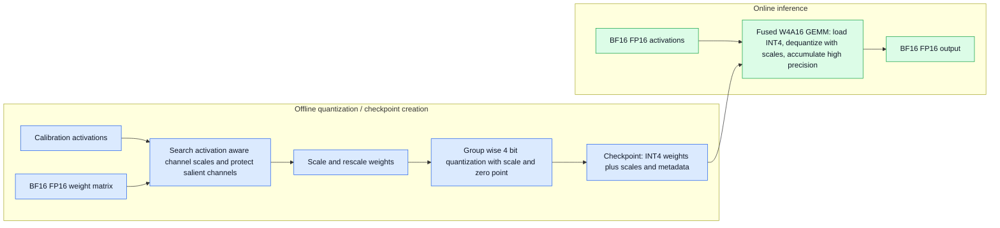
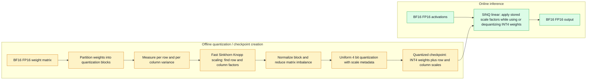

# SINQ vs AWQ on Qwen3.5-9B: ARC-Challenge and MMLU-Redux

## Status
This study combines the ARC-Challenge and MMLU-Redux evaluations of Qwen3.5-9B BF16, a recognized 4-bit AWQ weight-only checkpoint, and a newly SINQ-quantized 4-bit model.

## Results

### ARC-Challenge

The same deterministic first 300 items from the pinned ARC-Challenge test split were used for all models. The prompt required only `A`, `B`, `C`, or `D`, with thinking disabled and a 16-token output limit.

- **BF16:** 278/300 — **92.67%**
- **AWQ 4-bit:** 278/300 — **92.67%**
- **SINQ 4-bit:** 280/300 — **93.33%**

Request time on the RTX 3090:

- BF16: 41.26 s
- AWQ: 41.68 s
- SINQ: 140.93 s

### MMLU-Redux

The subset contains 10 valid questions from each of the 30 MMLU-Redux subjects. Records with no valid corrected answer in A–D were excluded before selection.

- **BF16:** 222/300 — **74.00%**
- **AWQ 4-bit:** 227/300 — **75.67%**
- **SINQ 4-bit:** 222/300 — **74.00%**

Request time on the RTX 3090:

- BF16: 59.06 s
- AWQ: 63.38 s
- SINQ: 253.23 s

All models used the same question IDs within each benchmark, two output tokens per response, and had no truncated or unparsed responses in the final runs.

## Interpretation
SINQ preserved accuracy relative to BF16 on both benchmarks. It was slightly ahead on ARC-Challenge and equal to BF16 on MMLU-Redux. AWQ matched BF16 on ARC-Challenge and was 1.67 percentage points ahead on MMLU-Redux. The results do not show a general SINQ accuracy advantage over AWQ.

The latency comparison is not production-grade: BF16 and AWQ used vLLM, while SINQ used Transformers + GemLite because vLLM SINQ support was not available in this environment. SINQ was slower in both tests. The SINQ path also used a reference PyTorch causal-convolution fallback because `causal_conv1d` was not installed.

The result supports further SINQ investigation, not immediate production adoption. A commercial decision also needs target-domain accuracy, concurrency throughput, cold-start time, memory and cost per token, long-context behavior, reliability, safety, and license review.

## Quantization schemas

The diagrams separate offline checkpoint creation from online inference. Both comparison models are weight-only at inference: activations remain BF16/FP16.

### AWQ: activation-aware offline scaling, W4A16 online inference

AWQ uses calibration activations offline to identify important channels and search scaling factors. The approved checkpoint stores 4-bit weights and null input/output activation quantization fields, so this comparison is W4A16 weight-only inference. At runtime, the kernel uses packed INT4 weights and stored scales while activations stay high precision.

### SINQ: calibration-free two-axis normalization, weight-only online inference

SINQ works on the weight matrix offline without an activation calibration set. It uses a fast Sinkhorn-Knopp-style procedure to find a second-axis scale factor and normalize per-row and per-column variances before uniform low-bit quantization. At runtime, stored scale factors are used by the SINQ linear implementation while activations remain BF16/FP16.

## Dataset and revisions

- ARC-Challenge: `allenai/ai2_arc`, config `ARC-Challenge`, test split, revision `210d026faf9955653af8916fad021475a3f00453`; 1,172 total items, first 300 evaluated.
- MMLU-Redux: `edinburgh-dawg/mmlu-redux`, revision `3720db6aeb3d019de48bf37916c1a54074ff4997`; 30 subjects × 100 records, 10 valid records per subject evaluated.
- BF16: `Qwen/Qwen3.5-9B`, revision `c202236235762e1c871ad0ccb60c8ee5ba337b9a`.
- AWQ: `cyankiwi/Qwen3.5-9B-AWQ-4bit`, revision `e4d2d39cede8c5d1716d824cd843e2889c648083`.
- SINQ: BF16 source loaded with `SinqConfig(nbits=4, group_size=32, tiling_mode="1D")`; the same 160 excluded module names as the approved AWQ recipe were excluded from conversion.

## Reproduction artifacts

Final JSONL files are in `results/`:

- `bf16-arc300.jsonl`, `awq-arc300.jsonl`, `sinq-arc300.jsonl`
- `bf16-300-exact.jsonl`, `awq-300-exact.jsonl`, `sinq-300-exact.jsonl`

The scripts for both evaluations are in `scripts/`. Superseded AIME, AMC, and partial MMLU runs remain clearly named in `results/` and are excluded from the final scores.

## Commercial-use limits
This is a two-benchmark screening study, not proof of commercial suitability. It does not measure production throughput under concurrency, end-to-end deployment cost, calibration sensitivity, safety, licensing, or customer-task quality.
