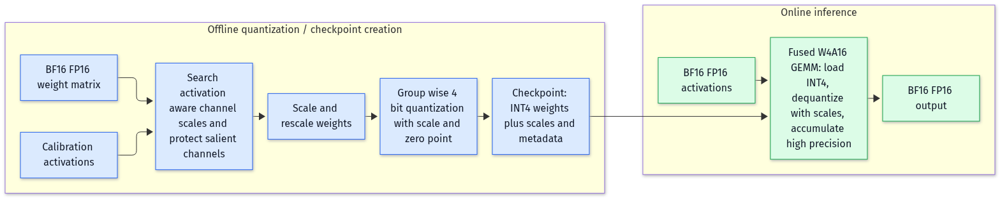
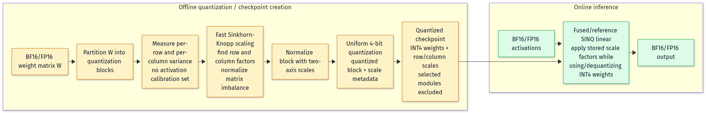

# SINQ vs AWQ on Qwen3.5-9B: MMLU-Redux comparison

## Results
The 300-question comparison is complete. The subset contains 10 valid questions from each of the 30 MMLU-Redux subjects. Records with no valid corrected answer in A–D were excluded before selection.

- **Qwen3.5-9B BF16:** 222/300 — **74.00%**
- **AWQ 4-bit weight-only:** 227/300 — **75.67%**
- **SINQ 4-bit weight-only:** 222/300 — **74.00%**

All models evaluated the same subject-balanced question IDs. Every valid gold answer was a single A–D option, every response produced two tokens, and no response was truncated or unparsed.

Request time on the RTX 3090:

- BF16: 59.06 seconds total, 0.197 seconds per question
- AWQ: 63.38 seconds total, 0.211 seconds per question
- SINQ: 253.23 seconds total, 0.844 seconds per question

Paired outcomes:

- BF16 vs AWQ: 211 both correct; 11 BF16-only; 16 AWQ-only
- BF16 vs SINQ: 211 both correct; 11 BF16-only; 11 SINQ-only
- AWQ vs SINQ: 210 both correct; 17 AWQ-only; 12 SINQ-only

## Interpretation
SINQ matched BF16 and scored 1.67 percentage points below AWQ on this 300-question MMLU-Redux subset. This result differs from the ARC-Challenge study, where SINQ was slightly ahead. Together, the results support further SINQ investigation but do not show a general accuracy advantage over AWQ.

The latency comparison is not a production benchmark: BF16 and AWQ used vLLM, while SINQ used Transformers + GemLite because vLLM SINQ support was not available in this environment. SINQ was about 4.3× slower in aggregate request time here. The SINQ path also used a reference PyTorch causal-convolution fallback because `causal_conv1d` was not installed.

## Dataset and scoring
- Dataset: [`edinburgh-dawg/mmlu-redux`](https://huggingface.co/datasets/edinburgh-dawg/mmlu-redux), revision `3720db6aeb3d019de48bf37916c1a54074ff4997`.
- MMLU-Redux contains 30 subjects × 100 questions = 3,000 records.
- The study selects the first 10 records with a valid A–D gold answer from each subject, in dataset order. This produces exactly 300 questions.
- The dataset contains annotation metadata. Invalid corrected answers were excluded; the full dataset inspection found 62 records without a valid A–D gold answer.
- Prompt asks for only A, B, C, or D. Qwen thinking is disabled. Decoding is greedy: temperature 0, top-p 1, seed 42, maximum 16 generated tokens.
- Exact letter match is the metric.

## Quantization schemas
These diagrams separate the offline checkpoint-creation stage from the online inference stage. They describe the relevant methods at the level needed for this comparison; implementation details can vary by kernel and checkpoint format.

### AWQ: activation-aware weight quantization, W4A16 inference



Source: [AWQ paper](https://arxiv.org/abs/2306.00978), Mermaid source: [`diagrams/awq-quantization.mmd`](diagrams/awq-quantization.mmd).

AWQ uses calibration activations **offline** to identify important activation channels and search channel-wise scaling factors. It then quantizes the rescaled weights, commonly into group-wise INT4 values with per-group scale metadata. In this study's approved checkpoint, the stored quantization config has 4-bit weights and null input/output activation quantization fields: the comparison is weight-only W4A16, despite AWQ using activations during its offline scale search.

At inference, activations remain BF16/FP16. A W4A16 kernel loads packed INT4 weights, applies the stored scales during the matrix multiplication, and accumulates in higher precision. The weights are not permanently expanded to BF16 for every layer operation.

### SINQ: Sinkhorn-normalized weight-only quantization



Source: [SINQ paper](https://arxiv.org/abs/2509.22944), Mermaid source: [`diagrams/sinq-quantization.mmd`](diagrams/sinq-quantization.mmd).

SINQ operates on the weight matrix **offline**, without an activation calibration set. It uses a fast Sinkhorn-Knopp-style procedure to find a second-axis scale factor and normalize per-row and per-column variances, reducing matrix imbalance before uniform low-bit quantization. The quantized checkpoint stores INT4 weights and the scale metadata required by the SINQ linear implementation.

At inference, activations remain BF16/FP16. The SINQ linear path uses the stored scale factors while applying or dequantizing the INT4 weights. This is also weight-only W4A16 behavior in the present study; it does not quantize the input or output activations.

## Reproduction
On `rtx3090-oct-22`, study directory `/home/ubuntu/reps/runrunrun/08-sinq-mmlu-redux`:

```bash
# BF16 or AWQ: start the vLLM server first
PYTHONPATH=/home/ubuntu/venvs/slam/lib/python3.12/site-packages \
  /home/ubuntu/venvs/slam/bin/python scripts/run_mmlu_redux.py \
  --backend vllm --label LABEL --model MODEL_ID \
  --per-subject 10 --max-new-tokens 16 --thinking off

# SINQ: stop vLLM, then use the SINQ environment
PYTHONPATH=/home/ubuntu/venvs/vllm/lib/python3.12/site-packages:/home/ubuntu/venvs/slam/lib/python3.12/site-packages \
  /home/ubuntu/venvs/sinq-aime/bin/python scripts/run_mmlu_redux.py \
  --backend sinq --label sinq-300-exact --model Qwen/Qwen3.5-9B \
  --per-subject 10 --max-new-tokens 16 --thinking off
```

The exact result files are:

- `results/bf16-300-exact.jsonl`
- `results/awq-300-exact.jsonl`
- `results/sinq-300-exact.jsonl`

## Commercial-use limits
This is a 300-question, single-benchmark accuracy comparison. It does not establish commercial suitability. A production decision still needs target-domain accuracy, throughput under concurrency, cold-start time, memory and cost per token, long-context behavior, reliability, safety, and license review for Qwen, the AWQ checkpoint, SINQ, GemLite, and the serving stack.
